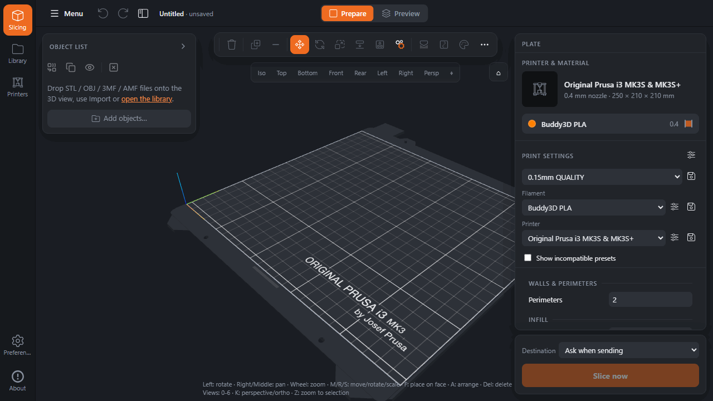
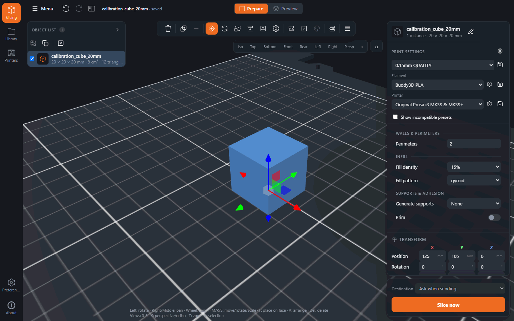
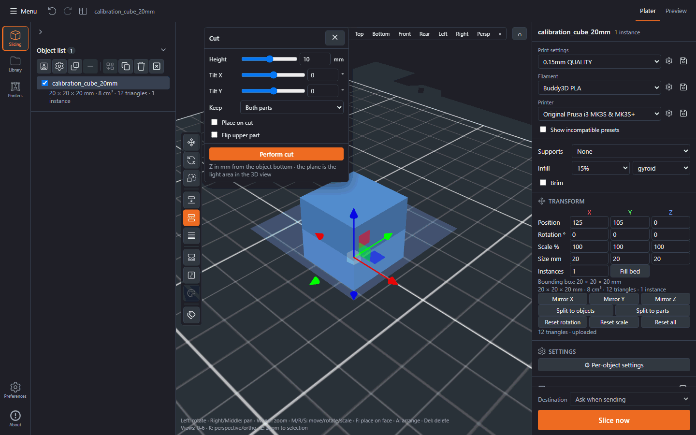
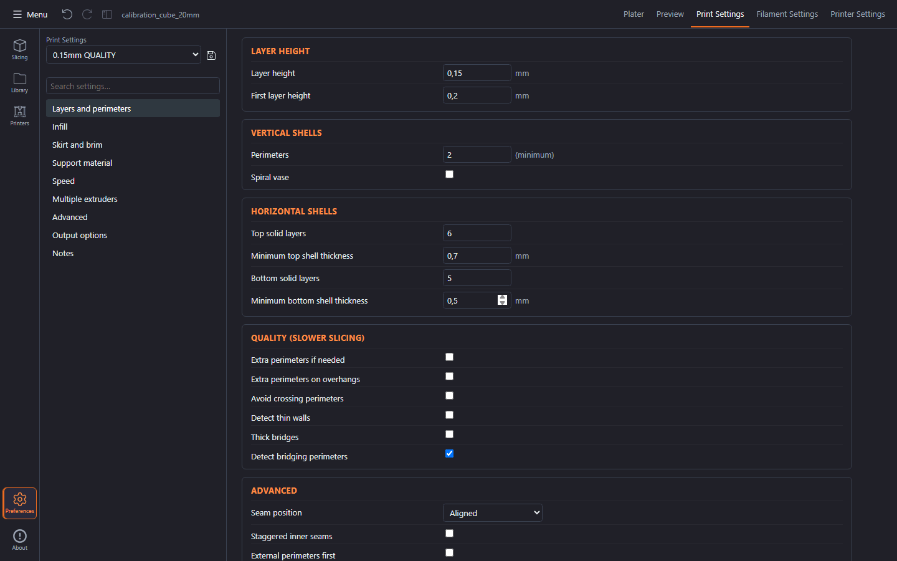
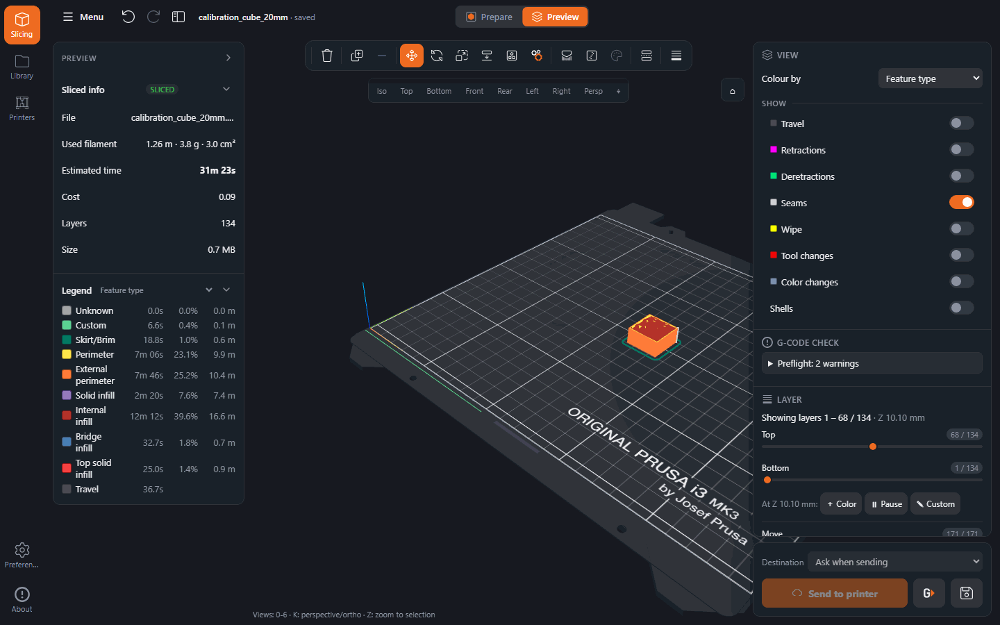
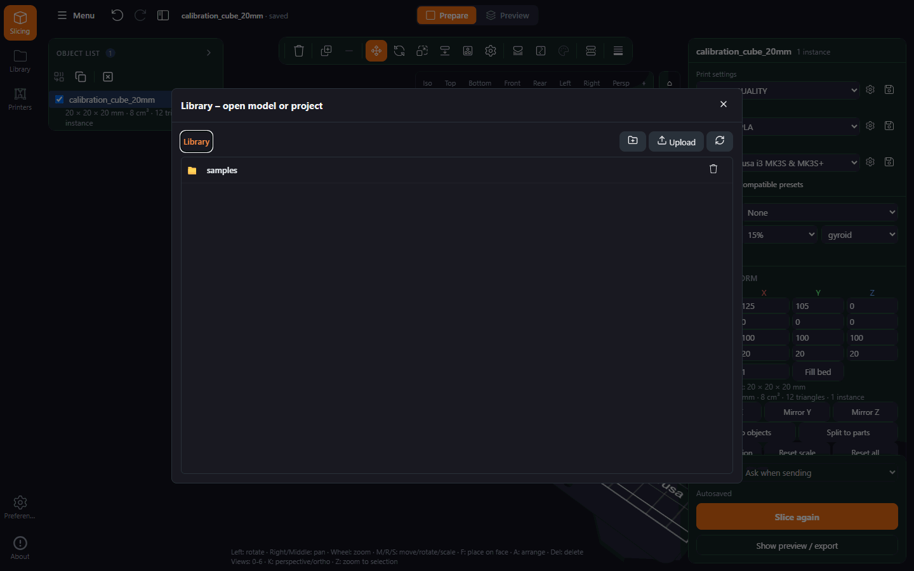

# WebSlicer

A full-featured 3D printing slicer in the browser. WebSlicer runs the **original PrusaSlicer engine**
(CLI) on the server and brings the plater, settings, profiles, G-code preview and printer upload to
any browser – on a PC, a tablet, a phone or the workshop laptop.



> **Print at your own risk.** WebSlicer slices and sends G-code to real machines. Check the
> temperatures and the plate yourself before a print starts; the safety checks reduce the risk but
> cannot remove it. The software comes without warranty (AGPL-3.0) – a print that damages a printer, a
> part or a room is your own responsibility. Details: [docs/safety.md](docs/safety.md),
> [SECURITY.md](SECURITY.md).

  

## Features

- **3D plater** (Three.js): import STL / OBJ / 3MF / AMF / STEP, move / rotate / scale, place on face,
  arrange, duplicate, instances, mirror, merge, cut, per-object settings and a tool strip that floats
  between the two cards over the scene, with the open tool's controls and its key hints in the context
  panel. A rail on the far left holds Slicing, Library, Printers, Preferences and About, and the 48 px
  top bar's menu carries import and the export list; the settings open from the cog of each preset row.
- **Volumes and height ranges** like PrusaSlicer: modifiers, support enforcers/blockers, negative
  volumes, extra parts, and variable layer height.
- **All slicing options** of the installed PrusaSlicer, sorted into the familiar Print / Filament /
  Printer tabs with Simple / Advanced / Expert mode, search and modified markers.
- **Vendor profiles**: all PrusaSlicer bundles (35 vendors) with inheritance and compatibility rules;
  user presets are PrusaSlicer-compatible `.ini` files.
- **Slicing** with the real engine (FFF and SLA), progress over server-sent events and a job queue.
- **G-code preview**: toolpaths by feature or colour scheme, layer and move sliders, legend with time
  and filament, colour change / pause / custom G-code at a layer.
- **Export**: G-code (also binary `.bgcode`), project 3MF (opens in desktop PrusaSlicer), config `.ini`.
- **Printers**: upload to PrusaLink, OctoPrint and Klipper/Moonraker, guarded by a preset-match gate,
  **G-code preflight** and configuration limits (see [docs/safety.md](docs/safety.md)).
- **File library** on a mounted folder or NAS, and **autosave** that restores the plater after a reload.
- **MCP endpoint** at `/mcp`, so an assistant can browse presets and library, build a project and slice
  it – see [docs/mcp.md](docs/mcp.md).

## How it is built

- `web/` – React 19, three.js and Zustand: plater, settings, G-code preview.
- `shared/` – pure TypeScript shared by web and server: API contract types, geometry, packing.
- `server/` – Node 22 and Express: routes → services → the PrusaSlicer CLI, slice jobs over SSE,
  presets, library, printer upload and the `/mcp` endpoint.
- `e2e/` – the Playwright suite, `proxmox/` – the LXC installer, `docs/` – the guides.

The layout in detail is in [docs/development.md](docs/development.md).

Feature-by-feature comparison with PrusaSlicer: [docs/Feature-Comparison.md](docs/Feature-Comparison.md).
Not included yet (see [TODO.md](TODO.md)): text/SVG embossing, a measurement tool, a G-code viewer for
library files; otherwise the slicing result equals PrusaSlicer because the same engine is used.

## Quick start

Docker Compose:

```bash
docker compose up -d
# → http://localhost:8080
```

Once the first release is published, no build is needed either:
`docker run -d -p 8080:8080 -v webslicer-data:/data -v /path/to/models:/library ghcr.io/movieaddicted86/webslicer:latest`
– on a NAS with `-e PUID=99 -e PGID=100`
([details](docs/installation.md#run-the-published-image)). The published image is **amd64 only** for
now; on arm64 build it locally with `docker compose build`.

Proxmox VE (LXC), on the host as root:

```bash
bash -c "$(curl -fsSL https://raw.githubusercontent.com/movieaddicted86/webslicer/main/proxmox/webslicer-lxc.sh)"
```

On first start pick your printer in the _Printers_ dialog, drag a model into the 3D view and click
**Slice now**. Installation details (Docker without Compose, reverse proxy, Proxmox advanced mode,
PrusaSlicer pinning): [docs/installation.md](docs/installation.md). All environment variables:
[docs/configuration.md](docs/configuration.md).

**Updates.** WebSlicer never updates itself, but it tells you when the repository has moved on: the
server compares its build commit (`GIT_COMMIT`, passed by Compose/CI/the Proxmox installer) with the
head of your branch once a day, and a dismissible chip next to the rail's **About** item plus the About
dialog link to the new commits or release. Set `WEBSLICER_UPDATE_CHECK=off` to switch the check – and
every outbound request – off. Details: [docs/installation.md#update-notice](docs/installation.md#update-notice).

## A quick tour

The 3D view fills the window right of the rail, with the object list and the context panel as cards
floating over it – folding a card or hiding the panels never moves or resizes the canvas. The object
list card folds to its header and its width (276 px by default) is draggable. The 48 px top bar holds
the **Menu**, undo/redo, hide-panels, the project name, the centred **Prepare | Preview** switch and
the update notice. The tool strip floats over the top of the scene, centred between the two cards: it
opens every tool (move, rotate, scale, place on face, arrange and its settings, painting, cut, variable
layer height) and carries delete and add/remove instance; a narrow band turns its trailing groups into
an overflow menu. The open tool's controls take over the context panel, with its one primary action
pinned at the bottom and the mouse and key hints below the controls. The context panel otherwise
follows the selection: with nothing on the plater it shows the printer card, the preset rows, the quick
settings and the Slice button; selecting an object adds its **Transform**, **Settings**, **Parts** and
**Layer ranges** cards, and the footer card keeps the destination and Slice in view. The **Menu** in
the top bar holds import models and presets and the **Export** list (project 3MF, settings, presets
bundle, G-code, save to library); the rail holds the app's places and dialogs, **Preferences** the
visibility mode and the panel layout reset, and each preset row's cog the print/filament/printer
settings; **hide panels** gives the 3D view the full width.



The cut tool as an example of a tool panel – plane height and tilt, keep upper/lower/both, and the cut
runs through the PrusaSlicer CLI. Its controls sit in the context panel; the hints at the bottom say
what the mouse buttons and Esc do.



Print settings are the full PrusaSlicer option set, grouped into pages; the mode switch decides how many
options are shown.



The G-code preview with toolpaths by feature, the layer slider, layer codes and the legend with print
time and filament per feature; the **Sliced info** and **Legend** cards sit in the object list card,
and the panel on the right holds the **View**, **G-code check** and **Layer** cards above a footer with
**Send to printer** and the export.



The file library can be a shared folder or a NAS mount: models, projects and finished G-code.



## Documentation

- [docs/features.md](docs/features.md) – what the plater, settings, preview and printer support do
- [docs/installation.md](docs/installation.md) – Docker, Proxmox LXC, updates, model library, PrusaSlicer pinning
- [docs/configuration.md](docs/configuration.md) – all environment variables in one table
- [docs/mcp.md](docs/mcp.md) – MCP setup, clients and tools
- [docs/development.md](docs/development.md) – repo layout, commands, tests and CI
- [docs/safety.md](docs/safety.md) – configuration limits and G-code preflight
- [docs/Feature-Comparison.md](docs/Feature-Comparison.md) – PrusaSlicer ↔ WebSlicer feature inventory
- [docs/MCP-Concept.md](docs/MCP-Concept.md) and [docs/UAT.md](docs/UAT.md) – agent endpoint concept, acceptance test plan
- [CHANGELOG.md](CHANGELOG.md) – versions, [TODO.md](TODO.md) – roadmap
- [docs/archive/](docs/archive/) – finished reports, work packages and long-form changelog entries, kept for traceability

The screenshots above are generated: `npm run docs:screenshots` drives the Docker image with Playwright
and refreshes `docs/images/`; the animation at the top comes from `npm run docs:gif`.

## Contributing

Issues and pull requests are welcome – start with [CONTRIBUTING.md](CONTRIBUTING.md). It links the
binding rules for code, tests and commits and lists the commands, including the E2E suite.

## License

WebSlicer is licensed under the **GNU Affero General Public License, version 3 or later** (`LICENSE`),
like PrusaSlicer itself. PrusaSlicer is © Prusa Research; WebSlicer is an independent project and not
affiliated with Prusa Research. The UI icons are PrusaSlicer's artwork (AGPL-3.0), copied and
recoloured. The bundled JavaScript dependencies, the icon source and the PrusaSlicer source link are
listed in [THIRD_PARTY_NOTICES.md](THIRD_PARTY_NOTICES.md).
