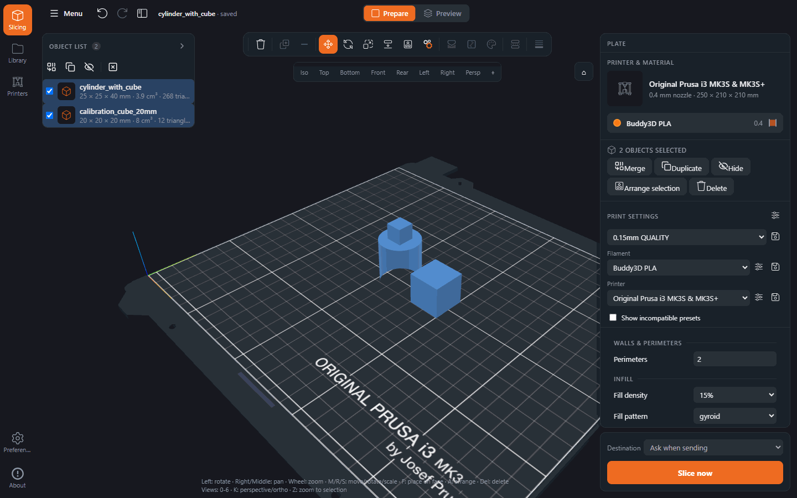

# WebSlicer

A full-featured 3D printing slicer in the browser. WebSlicer runs the **original PrusaSlicer engine**
(CLI) on the server and brings the plater, settings, profiles, G-code preview and printer upload to
any browser – on a PC, a tablet or the workshop laptop.



  

## Features

- **3D plater** (Three.js): import STL / OBJ / 3MF / AMF / STEP, move / rotate / scale, place on face,
  arrange, duplicate, instances, mirror, merge, cut, per-object settings and a left tool bar with one
  panel per tool.
- **Volumes and height ranges** like PrusaSlicer: modifiers, support enforcers/blockers, negative
  volumes, extra parts, and variable layer height.
- **All slicing options** of the installed PrusaSlicer, sorted into the familiar Print / Filament /
  Printer tabs with Simple / Advanced / Expert mode, search and modified markers.
- **Vendor profiles**: all PrusaSlicer bundles (35 vendors) with inheritance and compatibility rules;
  user presets are PrusaSlicer-compatible `.ini` files.
- **Slicing** with the real engine (FFF and SLA), progress over server-sent events and a job queue.
- **G-code preview**: toolpaths by feature or colour scheme, layer and move sliders, legend with time
  and filament, colour change / pause / custom G-code at a layer.
- **Export**: G-code (also binary `.bgcode`), project 3MF (opens in desktop PrusaSlicer), config `.ini`.
- **Printers**: upload to PrusaLink, OctoPrint and Klipper/Moonraker, guarded by a preset-match gate,
  **G-code preflight** and configuration limits (see [docs/safety.md](docs/safety.md)).
- **File library** on a mounted folder or NAS, and **autosave** that restores the plater after a reload.
- **MCP endpoint** at `/mcp`, so an assistant can browse presets and library, build a project and slice
  it – see [docs/mcp.md](docs/mcp.md).

## How it is built

- `web/` – React 19, three.js and Zustand: plater, settings, G-code preview.
- `shared/` – pure TypeScript shared by web and server: API contract types, geometry, packing.
- `server/` – Node 22 and Express: routes → services → the PrusaSlicer CLI, slice jobs over SSE,
  presets, library, printer upload and the `/mcp` endpoint.
- `e2e/` – the Playwright suite, `proxmox/` – the LXC installer, `docs/` – the guides.

The layout in detail is in [docs/development.md](docs/development.md).

Feature-by-feature comparison with PrusaSlicer: [docs/Feature-Comparison.md](docs/Feature-Comparison.md).
Not included yet (see [TODO.md](TODO.md)): text/SVG embossing, a measurement tool, a G-code viewer for
files from the library. The slicing result is otherwise identical to PrusaSlicer because the same engine
is used.

## Quick start

Docker Compose:

```bash
docker compose up -d
# → http://localhost:8080
```

Proxmox VE (LXC), on the host as root:

```bash
bash -c "$(curl -fsSL https://raw.githubusercontent.com/movieaddicted86/webslicer/main/proxmox/webslicer-lxc.sh)"
```

On first start pick your printer in the _Printers_ dialog, drag a model into the 3D view and click
**Slice now**. Installation details (Docker without Compose, reverse proxy, Proxmox advanced mode,
PrusaSlicer pinning): [docs/installation.md](docs/installation.md). All environment variables:
[docs/configuration.md](docs/configuration.md).

**Updates.** WebSlicer never updates itself, but it tells you when the repository has moved on: the
server compares its build commit (`GIT_COMMIT`, passed by Compose/CI/the Proxmox installer) with the
head of your branch once a day, and a dismissible chip plus the About dialog link to the new commits
or release. Set `WEBSLICER_UPDATE_CHECK=off` to switch the check – and every outbound request – off.
Details: [docs/installation.md#update-notice](docs/installation.md#update-notice).

## A quick tour

The plater with the tool bar, the object list and the quick settings. Move, rotate and scale have their
own bar entries; painting, cut and layer height open a panel next to the bar.


The cut tool as an example of a tool panel – plane height and tilt, keep upper/lower/both, and the cut
runs through the PrusaSlicer CLI.


Print settings are the full PrusaSlicer option set, grouped into pages; the mode switch decides how many
options are shown.


The G-code preview with toolpaths by feature, the layer slider, layer codes and the legend with print
time and filament per feature.


The file library can be a shared folder or a NAS mount: models, projects and finished G-code.


## Documentation

- [docs/features.md](docs/features.md) – what the plater, settings, preview and printer support do
- [docs/installation.md](docs/installation.md) – Docker, Proxmox LXC, updates, model library, PrusaSlicer pinning
- [docs/configuration.md](docs/configuration.md) – all environment variables in one table
- [docs/mcp.md](docs/mcp.md) – MCP setup, clients and tools
- [docs/development.md](docs/development.md) – repo layout, commands, tests and CI
- [docs/safety.md](docs/safety.md) – configuration limits and G-code preflight
- [docs/Feature-Comparison.md](docs/Feature-Comparison.md) – PrusaSlicer ↔ WebSlicer feature inventory
- [docs/MCP-Concept.md](docs/MCP-Concept.md) – the concept behind the agent endpoint
- [docs/UAT.md](docs/UAT.md) – acceptance test plan
- [CHANGELOG.md](CHANGELOG.md) – versions, [TODO.md](TODO.md) – roadmap
- [docs/archive/](docs/archive/) – finished reports and work packages, kept for traceability

The screenshots above are generated: `npm run docs:screenshots` drives the Docker image with Playwright
and refreshes `docs/images/`.

## Contributing

Issues and pull requests are welcome – start with [CONTRIBUTING.md](CONTRIBUTING.md). It links the
binding rules for code, tests and commits and lists the commands, including the E2E suite.

## License

WebSlicer is licensed under the **GNU Affero General Public License, version 3 or later** (`LICENSE`),
like PrusaSlicer itself. PrusaSlicer is © Prusa Research; WebSlicer is an independent project and not
affiliated with Prusa Research. The bundled JavaScript dependencies and the PrusaSlicer source link are
listed in [THIRD_PARTY_NOTICES.md](THIRD_PARTY_NOTICES.md).
